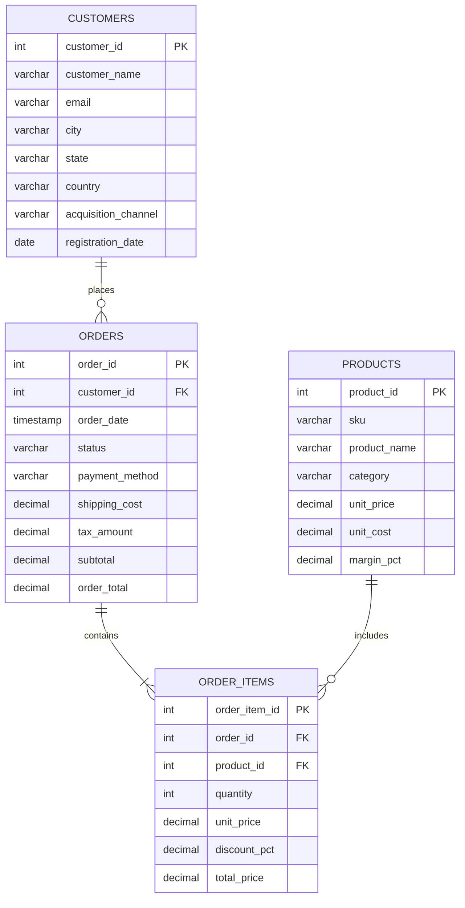

# 📚 Data Dictionary & Schema Documentation

This document provides a comprehensive overview of the relational database architecture, entity relationships, fields, data types, and business definitions used in the **E-Commerce Sales & Customer Retention Analysis** project.

---

## 🗂️ Relational Data Model (ERD)

---

## 📋 Table Specifications

### 1. `customers`
Stores demographic and acquisition information for each registered customer.

| Field Name | Type | Constraints | Description |
| :--- | :--- | :--- | :--- |
| `customer_id` | `INTEGER` | `PRIMARY KEY` | Unique identifier for each customer. |
| `customer_name` | `VARCHAR(100)` | `NOT NULL` | Full legal name of the registered customer. |
| `email` | `VARCHAR(150)` | `NOT NULL UNIQUE` | Registered customer email address. |
| `city` | `VARCHAR(80)` | `NOT NULL` | Billing/Shipping city. |
| `state` | `VARCHAR(50)` | `NOT NULL` | Two-letter state abbreviation (US). |
| `country` | `VARCHAR(50)` | `DEFAULT 'USA'` | Country of customer origin. |
| `acquisition_channel` | `VARCHAR(50)` | `NOT NULL` | Marketing acquisition channel (`Organic Search`, `Paid Social`, `Google Ads`, `Email Referral`, `Influencer Partner`). |
| `registration_date` | `DATE` | `NOT NULL` | Account creation timestamp. |

---

### 2. `orders`
Contains header-level records for every purchase transaction (50,000+ records).

| Field Name | Type | Constraints | Description |
| :--- | :--- | :--- | :--- |
| `order_id` | `INTEGER` | `PRIMARY KEY` | Unique transaction identifier. |
| `customer_id` | `INTEGER` | `FOREIGN KEY` | Reference to `customers.customer_id`. |
| `order_date` | `TIMESTAMP` | `NOT NULL` | Date and time the order was placed. |
| `status` | `VARCHAR(30)` | `NOT NULL` | Order fulfillment status (`Completed`, `Returned`, `Cancelled`). |
| `payment_method` | `VARCHAR(50)` | `NOT NULL` | Checkout payment gateway (`Credit Card`, `PayPal`, `Apple Pay`, `UPI / Bank Transfer`). |
| `shipping_cost` | `DECIMAL(10, 2)` | `DEFAULT 0.00` | Shipping fee charged ($5.99 if subtotal < $75, free otherwise). |
| `tax_amount` | `DECIMAL(10, 2)` | `DEFAULT 0.00` | State and local sales tax amount. |
| `subtotal` | `DECIMAL(10, 2)` | `NOT NULL` | Sum of item total prices before shipping and taxes. |
| `order_total` | `DECIMAL(10, 2)` | `NOT NULL` | Final billed amount (`subtotal + shipping_cost + tax_amount`). |

---

### 3. `order_items`
Contains itemized transaction details (93,000+ records).

| Field Name | Type | Constraints | Description |
| :--- | :--- | :--- | :--- |
| `order_item_id` | `INTEGER` | `PRIMARY KEY` | Unique identifier for the line item. |
| `order_id` | `INTEGER` | `FOREIGN KEY` | Reference to `orders.order_id`. |
| `product_id` | `INTEGER` | `FOREIGN KEY` | Reference to `products.product_id`. |
| `quantity` | `INTEGER` | `CHECK(quantity > 0)` | Number of units purchased in this order line. |
| `unit_price` | `DECIMAL(10, 2)` | `NOT NULL` | Catalog retail price per unit at time of sale. |
| `discount_pct` | `DECIMAL(5, 2)` | `DEFAULT 0.00` | Promotional coupon or markdown rate (e.g., 0.10 for 10% off). |
| `total_price` | `DECIMAL(10, 2)` | `NOT NULL` | Net line price after item discount: `quantity * unit_price * (1 - discount_pct)`. |

---

### 4. `products`
Catalog of SKUs spanning 6 core e-commerce categories.

| Field Name | Type | Constraints | Description |
| :--- | :--- | :--- | :--- |
| `product_id` | `INTEGER` | `PRIMARY KEY` | Unique product identifier. |
| `sku` | `VARCHAR(50)` | `NOT NULL UNIQUE` | Internal stock-keeping unit barcode. |
| `product_name` | `VARCHAR(150)` | `NOT NULL` | Full title of the merchandise item. |
| `category` | `VARCHAR(60)` | `NOT NULL` | Merchandise category (`Electronics`, `Apparel & Fashion`, `Home & Living`, `Beauty & Wellness`, `Sports & Outdoors`, `Books & Productivity`). |
| `unit_price` | `DECIMAL(10, 2)` | `NOT NULL` | Standard selling price. |
| `unit_cost` | `DECIMAL(10, 2)` | `NOT NULL` | Cost of Goods Sold (COGS) to procure or manufacture. |
| `margin_pct` | `DECIMAL(5, 2)` | `NOT NULL` | Gross profit margin percentage: `((unit_price - unit_cost) / unit_price) * 100`. |

---

## 🔍 Analytical Views

### `vw_order_details`
Denormalized analytical view joining orders, customers, items, and products for fast multi-dimensional business intelligence slicing and BI export.

### `vw_customer_lifetime_summary`
Customer-level analytical rollup computing first acquisition date, latest active date, total lifetime orders, aggregate spend, and repeat buyer classification flag.
